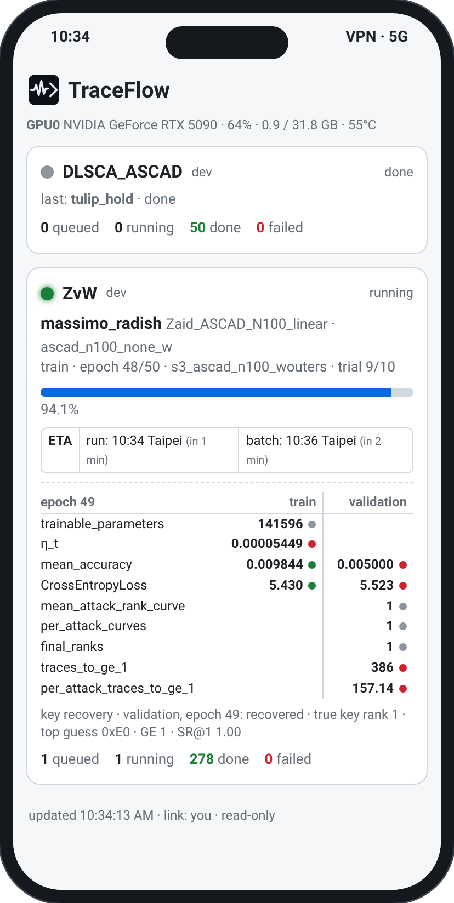
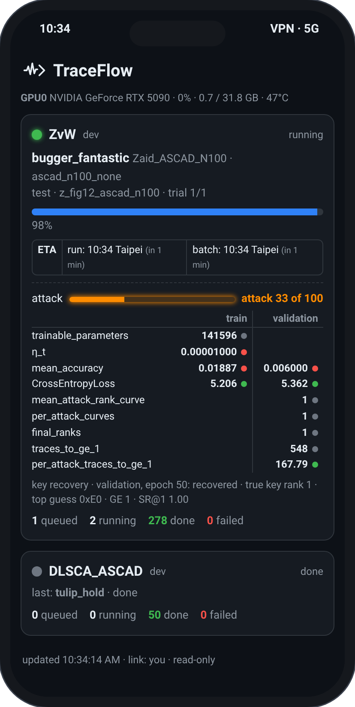
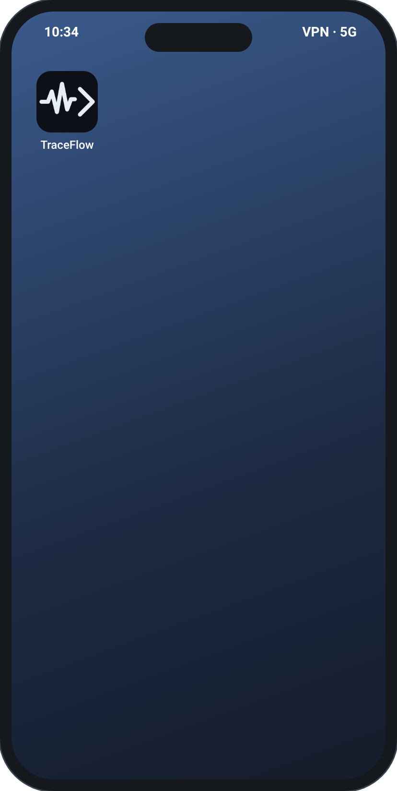
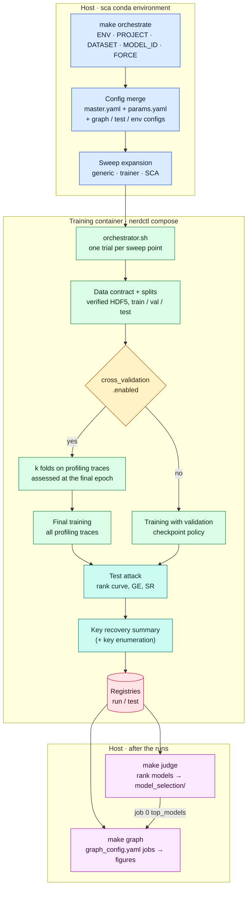

<h1 align="center">
  <picture>
    <source media="(prefers-color-scheme: dark)" srcset="services/visualization/vscode_monitor/brand/traceflow-lockup-dark.svg">
    
  </picture>
</h1>

<p align="center"><b>An Extensible Framework for Reproducible Deep Learning Side-Channel Analysis</b></p>

TraceFlow runs deep-learning profiled side-channel attacks end to end, and keeps the receipts.

| Step | What TraceFlow does |
|---|---|
| Data | builds verified datasets from trace databases |
| Sweep | NN architectures × hyper-parameters × CMD runs  →  Graph|
| Train | Choose Dataset →  Training-testing with optional [k-fold cross-validation, then a final fit] |
| Attack | rank, guessing entropy and success rate on held-out traces; key recovery  → Test the Model|
| Record | every run hash-identified in registries, with its full config snapshot; every result file sealed (Ed25519) |
| Report | Keys recovered, Metrics (primary and their dependency), judge the best model, draws the figures |
| Monitor | the TraceFlow panel in VS Code: GPUs, runs, ETA, queues, live metrics; a read-only status page for phones and shared links |

### Supported datasets

In the \<project>/config/<a href="projects/DLSCA_ASCAD/config/params.yaml">params.yaml</a> or in TraceFlow Monitor/PARAMS.YAML →  One key in a `data:` entry, `type:`, select the dataset; TraceFlow applies system settings corresponding to the `data:type` ([details](services/doc/TUTORIAL.md)).

| `type:` | Dataset | Size (profiling / attack × samples) | Label the attack uses | `sca. attack_byte` | Cross-validation folds |
|---|---|---|---|---|---|
| `ASCADf` | ASCAD v1 fixed key (ATMega8515, masked AES) | 50,000 / 10,000 × 700 | `Sbox[p ^ k]` | 2 (raw traces: any verified byte) | attacked |
| `ASCADr` | ASCAD v1 random key (ATMega8515, masked AES) | 200,000 / 100,000 × 1,400 | `Sbox[p ^ k]`, a different key on each profiling trace | 2 (raw traces: any verified byte) | not attacked: `perform_attack.validation.attack_times: 0`<br><small><small>(the key is variable: a fold's traces have no single key to rank)</small> |
| `CHES_CTF_2018` | CHES CTF 2018 (STM32F4, masked AES) | 45,000 / 5,000 × 2,200 | `Sbox[p ^ k]`, different profiling and attack keys | 0..15 | attacked (profiling key; the test uses the attack key) |
| `AES_RD` | AES with random delays (ATmega16) | 25,000 / 25,000 × 3,500 | `Sbox[p ^ k]` | 0..15 | attacked |
| `DPAv4` | DPA contest v4, known mask (ATmega163) | 4,500 / 500 × 4,000 | `Sbox[p0 ^ k0] ^ mask` | 0 | attacked |
| `AES_HD` | AES_HD (FPGA, unprotected, last round) | 50,000 / 25,000 × 1,250 | `InvSbox[c11 ^ k] ^ c7` | 11 | attacked |

The user can use **TraceFlow panel** in VS Code or \<project>/config/*.yaml</a> to control, configure or monitor their experiments.

**Authors:** Shraddha Mishra.

Using TraceFlow in research? Please cite it: [`CITATION.cff`](CITATION.cff).

## Contents

1. [From clone to first experiment with the TraceFlow panel](#1-from-clone-to-first-experiment-with-the-traceflow-panel)
2. [How a run flows](#2-how-a-run-flows)
3. [Configuration Files](#3-configuration-files)
4. [Repository layout](#4-repository-layout)
5. [Documentation map](#5-documentation-map)

Prefer the terminal operation through CMDs? Every step and `make` target: [services/doc/08_command_line.md](services/doc/08_command_line.md).

---

## 1. From clone to first experiment with the TraceFlow panel

<p>
  <picture>
    <source media="(prefers-color-scheme: dark)" srcset="services/visualization/vscode_monitor/brand/traceflow-mark-dark.svg">
    
  </picture>
  This icon in the VS Code Activity Bar, a power trace running into a forward
  chevron, is the <b>TraceFlow panel</b>. 
</p>
<br clear="left">

### 1.1 Requirements

Set up TraceFlow once (§1.1–1.4); from there your DL-SCA research is a child's play. 

| Needed for | What |
|---|---|
| Host | Linux (Ubuntu 24.04, like the training image), NVIDIA GPU with a working `nvidia-smi` |
| Host environment | Miniconda or Anaconda; the `sca` env runs the Makefile, orchestration, judge and graphs |
| Training | runs in a container: rootful `containerd`, `nerdctl` (compose v2, BuildKit), NVIDIA Container Toolkit |
| The panel | VS Code (Remote-SSH works), with its `code` command on the PATH |
| The status page (optional) | a phone on the server's network (the same Wi-Fi, or its VPN) and a TCP port its firewall lets through ([guide 11](services/doc/11_phone_status_share.md)) |

### 1.2 Clone


| From | You get |
|---|---|
| GitHub | the code; a run downloads the database it selects from its official source, SHA-256 checked ([Supported databases](services/doc/TUTORIAL.md)) |
| the lab server | the code plus the ASCADv1 databases and models (a 7.3 GB submodule); the other databases come from their own submodules on first use |

```bash
git clone git@github.com:IIS-ACE-lab/TraceFlow.git                       # GitHub
git clone --recurse-submodules nv1:/srv/git/SCA.git TraceFlow             # lab server
git -c protocol.file.allow=always clone --recurse-submodules /srv/git/SCA.git TraceFlow   # on nv1 itself
git submodule update --init                                               # an existing lab-server clone
```

### 1.3 Create the `sca` environment (it installs the panel)

```bash
cd TraceFlow
bash services/side_channel_core/scripts/setup.sh [--sys-deps]   # --sys-deps: also apt packages (sudo)
conda activate sca
```

Then run *Developer: Reload Window*; the TraceFlow icon appears in the Activity Bar.

The panel is for VS Code only. The installer skips Cursor, VSCodium and friends; in VS Code, `make panel ENV=dev` installs it later.
Host and image both run Python 3.12, so nothing works on the host that the container cannot run.
What the script runs and the files it uses, and problems: [01 Setting up the `sca` environment](services/doc/01_setting_up_the_sca_environment.md).

### 1.4 Install the container runtime

Rootful containerd, nerdctl (compose v2, BuildKit) and the NVIDIA Container Toolkit: [02 Container runtime and image build](services/doc/02_container_runtime_and_image_build.md). Then check:

```bash
sudo systemctl is-active containerd     # must print: active
sudo nerdctl --version
```

### 1.5 Open the panel

Open the `TraceFlow` folder in VS Code (locally or over Remote-SSH) and click the icon. No icon? Run `make panel ENV=dev`, then *Developer: Reload Window*.

<p align="center">
  <picture>
    <source media="(prefers-color-scheme: dark)" srcset="services/visualization/vscode_monitor/brand/TraceFlow_Monitor_dark.svg">
    
  </picture>
</p>

The TraceFlow Monitor Panel follows your system's light or dark setting.

*running here* shows `(+N)` when an experiment has several processes (queue line, orchestrator, trainer); hover lists them.
The share button on the *TraceFlow Monitor* title line (1, top right, glowing) serves a read-only status page for any browser, desktop or phone, and gives each person you share it with a link and QR code. A phone opens them only on the server's network, or on its VPN with the port allowed; the address is found by itself ([guide 11](services/doc/11_phone_status_share.md)). The page follows the phone's light or dark setting:

<table>
<tr>
<td align="center" width="33%"></td>
<td align="center" width="33%"></td>
<td align="center" width="33%"></td>
</tr>
<tr>
<td valign="top"><b>Now · light</b><br>DLSCA_ASCAD, its last run done: grey light, 50 runs done.</td>
<td valign="top"><b>Example · dark</b><br>While a run trains: green light, fold and epoch, progress, the panel's ETA table (run and batch ends, in Taipei time) and the latest metrics. Sample numbers.</td>
<td valign="top"><b>Home screen</b><br>After Share → Add to Home Screen, it opens full screen like an app.</td>
</tr>
</table>

A project's ENV and status appear once a run starts. Buttons that destroy or stop something (DELETE, Docker tear down, Kill session, Terminate Run) ask first: the panel is brave, not reckless.

### 1.6 Steps to Experiment

- TraceFlow is controled by <code>projects/&lt;project&gt;/config/</code> (<a href="#3-configuration-files">§3</a> maps which file drives what). 
- Set up new  project by creating <code>project:- name: "{name_for_project_root}"</code> in <a href="services/side_channel_core/config/master.yaml">master.yaml</a>, and the {name_for_project_root} appears in TraceFlow Monitor and projects/{name_for_project_root} and empty configuration files are populated in  <code>projects/&lt;project&gt;/config/</code>.

- projects/[**P1**:DLSCA_ASCAD, &lt;**P2**&gt;] can be considered as the reference examples.

<table>
<tr><th>Step</th><th>Action</th><th>Where</th><th>Mind</th></tr>
<tr><td>1</td><td>Setup</td><td><a href="services/side_channel_core/config/master.yaml"><code>master.yaml</code></a></td><td>Register the project under <code>projects:</code>; on save the panel creates its <code>config/</code> and a section for it.</td></tr>
<tr><td rowspan="3">2</td><td rowspan="3">Plan<br><small>NOTE: changes reflect in the TraceFlow panel automatically.</small></td><td>(a) Figures: <a href="projects/DLSCA_ASCAD/README.md#figure-index-model-dataset-leakage-model-batch-size-epochs-optimizer">Figure index</a></td><td>What a figure needs: models, datasets, epochs, rank grid, graph job. One run per largest epoch value: smaller legend epochs are read from the same run.</td></tr>
<tr><td>(b) Experiments: queue config <code>fig#:</code> <a href="projects/DLSCA_ASCAD/config/experiment_queue.yaml">[CMD]</a></td><td>One key per figure, listing its <code>make</code> commands. The key becomes the batch label of every run it makes and a row in QUEUES; its comment says what the figure changes in <code>params.yaml</code>.</td></tr>
<tr><td>(c) Graphs: <code>graph: jobs: - id:</code> <a href="projects/DLSCA_ASCAD/config/graph_config.yaml">graph_config.yaml</a></td><td>Update it after the queue runs are done. A panel's job is the Graph job column of the Figure index; paper rank 0 is rank 1 here.</td></tr>
<tr><td>3</td><td>Experiment parameters</td><td>Configs → <a href="projects/DLSCA_ASCAD/config/params.yaml">params.yaml</a></td><td>Follow the <a href="projects/DLSCA_ASCAD/README.md#figure-index-model-dataset-leakage-model-batch-size-epochs-optimizer">Figure index</a> to set each parameter under its key. Every list is a sweep dimension, and lists multiply.<br><b>Define once:</b> <code>model:</code> (every <code>model_id</code>), <code>data:</code>, <code>deep_learning:</code>, <code>seed</code>, <code>device</code>, <code>num_workers</code>, <code>dataloader:</code>, <code>sca:</code>, <code>evaluation:</code>, <code>cross_validation:</code>, <code>perform_attack:</code>, <code>validation:</code>, <code>key_recovery_reporting:</code>, <code>metrics_cfg:</code>, <code>paths:</code>.<br><b>Define per experiment:</b> <code>trainer:</code>, <code>metrics_to_log:</code>. <b>PAY ATTENTION:</b> all that needs to change as per experiment.<br><b>Models:</b> <code>model:</code> → <b>Plan a Model</b> designs a layer model; a model's <b>Visualise</b> edits it (OK / Cancel / Reset), <b>Observe Trace</b> shows what each layer makes of an attack trace and <b>Download</b> saves the model's diagram (Full Version, Layer cards or Scaled Sparkline; trace lines, arrows, text_rules; PNG, PDF, SVG with graph_manager's export settings) in <code>paths.model_preview</code>, copied into the model folder of each run of it. <b>Import a Model</b> takes a model another study released (Keras HDF5) into <code>import_config.yaml</code> instead: tested, never trained (<a href="#testing-released-models-model-import">model import</a>).</td></tr>
<tr><td>4</td><td>Experiment runs<br><small>TraceFlow panel</small></td><td>QUEUES sub-panel under the &lt;project&gt; section</td><td>Choose the <code>fig#</code> you want to run → <b>Start</b>. TraceFlow Monitor follows the experiment even if the terminal is closed (tmux); the experiment status updates itself. Every command reads <code>params.yaml</code> as it starts: do not edit it mid-queue.</td></tr>
<tr><td rowspan="4">5</td><td rowspan="4">Plotting graphs</td><td>(a) From sweep to figure: Done tile → under a run, pick a metric → <b>Export to Graph Config</b> (or <b>Delete from Graph Config</b>)</td><td>The run joins (or starts) its batch's job for that metric in <a href="projects/DLSCA_ASCAD/config/graph_config.yaml">graph_config.yaml</a>: <code>models</code> with a comment per run naming what differs between them (the optimizer, the epochs…), <code>legend.labels</code> the same, source, metric and processes as picked, a header comment saying what the figure is. <b>Draw</b> plots it. A deleted run leaves every job; a job removed by hand offers <b>Shift ids</b> (later jobs, their folders and facets move down one id). Drawn figures: tick them in FIGURES → <b>Export to Facet</b> composes them side by side (a facet, <code>FACE_ID</code>). Same from a terminal: <code>make graph_export</code>, <code>make graph_delete</code>, <code>make graph_renumber</code>, <code>make graph_facet</code>, <code>make graph_facet_delete</code>.</td></tr>
<tr><td>(b) Or filter models: Configs → <a href="projects/DLSCA_ASCAD/config/model_filter.yaml">model_filter.yaml</a> → <b>Find models</b> Configs → <a href="projects/DLSCA_ASCAD/config/model_filter.yaml">model_filter.yaml</a> → <b>Find models</b></td><td>Finds the right models for the figure; their names are written to <a href="projects/DLSCA_ASCAD/artifacts/filtered_models.yaml">filtered_models.yaml</a> and the terminal.</td></tr>
<tr><td>(c) Graph settings: Configs → <a href="projects/DLSCA_ASCAD/config/graph_config.yaml">graph_config.yaml</a></td><td>i. Copy the output of 5(b) under <code>graph.jobs[id].models</code>; to rename them in the legend, set <code>legend.mode: custom</code> and edit <code>legend.labels</code>.<br>ii. Edit the rest of the figure's choices.<br><b>NOTE:</b> do not edit job <code>id: 0</code>: it is reserved for <a href="projects/DLSCA_ASCAD/config/model_judge.yaml">model_judge.yaml</a>, which fills its <code>top_models</code> automatically.</td></tr>
<tr><td>(d) Plot the graph: FIGURES sub-panel</td><td>i. Every job of <code>graph_config.yaml</code> appears in FIGURES.<br>ii. Choose the figure you want to plot → <b>Draw</b>.</td></tr>
<tr><td>6</td><td>Deleting models</td><td>HOUSEKEEPING sub-panel</td><td>a. Filter the runs (ENV, MODEL_ID, DATASET, STATUS, BATCH, NAME, PARAM).<br>b. Tick them (or Delete all) → <b>DELETE</b>: a dry run lists them → OK when you really mean it.</td></tr>
<tr><td>7</td><td>Judging models</td><td>Configs → <a href="projects/DLSCA_ASCAD/config/model_judge.yaml">model_judge.yaml</a></td><td>a. Edit the fields in the panel or the editor → <b>Judge</b>.<br>b. The names are exported to graph job 0's <code>top_models</code> automatically; the outputs are shown in the terminal and in <code>projects/DLSCA_ASCAD/model_selection/selected_model.yaml</code> (written by the first Judge).</td></tr>
</table>

#### Testing released models (model import)

TraceFlow also runs other studies' released models through its own test, without training them: `params.yaml` → `model:` → **Import a Model** (or by hand, `projects/<P>/config/import_config.yaml`), then `make import ENV=dev PROJECT=<P>`. The released file is read with h5py only (a Lambda layer, i.e. Python code, is refused), its layer list becomes a TraceFlow model entry, and the released file's SHA-256 joins the run's hash. In the run, TraceFlow builds that model, copies the released weights in (the first Dense layer after a Flatten reordered: Keras flattens channels-last, TraceFlow channels-first) and the **equality gate** compares both models' class probabilities on every test trace; then the standard test writes the usual metrics, key recovery and per-attack curves. The import gives what the file does not hold: its source, the data entry, the preprocessing, the leakage model, the seed and the attack (`perform_attack`; a Budget test takes the data entry's `attack_trace_budget`). `model_import.defaults` holds them for every import; a key an import leaves empty is the default's, a key it fills is its own. Several files of one import are `files: [{file, sha256}, ...]`, each file beside its own SHA-256, one run each. **Configs → import_config.yaml → Import** runs every import not DONE (new, failed or interrupted). Limits: Keras HDF5 files are converted automatically (Conv1D, BatchNormalization, pooling, Flatten, Dense, Dropout, ZeroPadding1D; a chain of layers); a PyTorch state dict needs its TraceFlow model entry and its gate can only check that every tensor arrived; ONNX is not supported; the preprocessing must be a TraceFlow `trace_normalization`; there is no training history ([`utils/model_import.py`](services/side_channel_core/utils/model_import.py)).

Forms save on Enter or when you leave the box, and comments survive; the editor works as well. TraceFlow is experiment friendly: try things in `ENV=dev`, every run is recorded and can be deleted. DLSCA_ASCAD has the loop's plan steps done for every paper figure. A new project: register it in `master.yaml` and save; the panel creates its `config/` ([§3](#3-configuration-files)).

### 1.7 Projects Reproduced

| Project | Reproduces | Guide |
|---|---|---|
| P1 `DLSCA_ASCAD` | Benadjila et al., *Deep learning for side-channel analysis and introduction to ASCAD database* (JCEN 2020) | [`projects/DLSCA_ASCAD/README.md`](projects/DLSCA_ASCAD/README.md) |
| P2 | to be decided | — |


### 1.8 When the panel cannot help

| Problem | Read |
|---|---|
| setup, the `sca` env, the panel install | [01 Setting up the `sca` environment](services/doc/01_setting_up_the_sca_environment.md) |
| containerd, nerdctl, image build, GPU in the container, disk space | [02 Container runtime and image build](services/doc/02_container_runtime_and_image_build.md) |
| `Permission denied`, root-owned artifacts, lock files | [03 File permissions](services/doc/03_file_permissions.md) |
| failed runs, DONE runs, sweep size, data errors, OOM, logs | [04 Running experiments](services/doc/04_running_experiments.md) |
| judge and graph errors | [05 Model judge and graphs](services/doc/05_model_judge_and_graphs.md) |
| `ModuleNotFoundError`, `PYTHONPATH`, unit tests, lint, a container running old code | [06 Python imports and tests](services/doc/06_python_imports_and_tests.md) |
| SSH keys, remotes, keeping GitHub and the lab server in sync | [07 Git and GitHub](services/doc/07_git_and_github.md) |
| a dataset type: fetching its database, its `data:` entry, `sca.attack_byte`, reading its runs | [Tutorial: training every dataset type](services/doc/TUTORIAL.md) |
| no VS Code, plain SSH, a step without a button | [08 TraceFlow from the command line](services/doc/08_command_line.md) · [09 DLSCA_ASCAD from the command line](services/doc/09_dlsca_ascad_command_line.md) |
| the status page: phones, shared links, a link that does not open | [11 The status page](services/doc/11_phone_status_share.md) |
| changing TraceFlow itself: a configuration key, a config file, the run hash, a dataset type, the blueprint | [10 To the developers](services/doc/10_to_the_developers.md) |
| the panel itself: every button, light and form | [`vscode_monitor/README.md`](services/visualization/vscode_monitor/README.md) |

- Every guide: [`services/doc/README.md`](services/doc/README.md). 
- Every run's full log: `projects/<P>/artifacts/<ENV>/generated_models/<model>/logs/`.

---

## 2. How a run flows



Per model, under `projects/<P>/artifacts/<env>/generated_models/<model_name>/` (the folders are `paths:` in `params.yaml`; NN a fold, epNNNN an epoch):

| Stage | Output |
|---|---|
| Config | `config/<model_name>_params.yaml`: the fully resolved snapshot, sealed by `snapshot_sha256` (an edited or truncated one is refused); `device.yaml`: the GPU, the library versions and the code commit |
| Data | `data/`: the verified database `<dataset_alias>.h5` and its splits `train.h5`, `val.h5` (training with validation), `test.h5` |
| Model | `model/<model_name>_trained.pt`, `<model_name>_checkpoint_manifest.json` (which checkpoint the test loads), `resolved_model.{json,yaml}` (the layers as built), `<model_name>_diagram.{png,pdf,svg}` once the planner's **Download** drew the model; `checkpoints/` only with `evaluation.validation.checkpointing: true` |
| Cross-validation | `cross_validation/`: `manifest.yaml`, `fold_indices.npz`, `folds/fold_NN/fold_result.yaml`, `aggregate/` (`mean_rank_curve.json`, `fold_rank_curves.npz`, `fold_results.json`, `scalar_statistics.json`, `summary.yaml`, `cross_validation_diagnostics.json`) |
| Metrics | `metrics/attack_metrics/scalars/<model_name>_metrics_<process>_history.jsonl` (one row per epoch: `metrics_to_log` and what they depend on), `arrays/<process>/<metric>/epNNNN.npy` (rank curves); under CV per fold `metrics/cross_validation/fold_NN/{scalars,arrays,key_recovery}/` and their mean in `mean/scalars/` |
| Key recovery | `metrics/key_recovery/`: `validation_history.jsonl`, `validation_best.json`, `test.json` (no test file when `perform_attack.test.attack_times: 0`) |
| External tests | `test/<key>/`: `test_settings.json`, `metrics/`, `logs/` of each **Test** run from `test_config.yaml` |
| Figures | `graphs/job_NNN_<name>/`: a graph job that draws only this run |
| Logs | `logs/Training.log`, `logs/all_logs.log` |

Every result file carries an Ed25519 seal (in the file, or a trailer `np.load` ignores); a reader refuses a file whose seal does not match.

Per project: `artifacts/{run_registry,test_registry}.json`, `artifacts/run_map.jsonl`, `artifacts/model_name_map.json`, `artifacts/done_model_names.yaml`, `artifacts/<env>/heartbeat.json`, `artifacts/<env>/model_preview/` (the planner's Download), `model_selection/`, `graphs/` (jobs of several runs, facets). There is no separate results index: the judge and the graph manager read each run's own folder.

### Reporting semantics

What a reported number means. The code is in `src/sca/rank_curve.py`, `src/sca/key_recovery.py` and `utils/cross_validation.py`.

| Number | Meaning |
|---|---|
| Key rank | one-based: the true key ranks 1 when it scores highest (the paper's rank 0). A key's score is its log-likelihood: the sum over the traces of the log of the float64 softmax of the logits, i.e. the log of the paper's product of probabilities, Eq. (4): the same order, without underflow. Each term is floored at `log(metrics_cfg.rank_log_eps)` (default `1e-40`, about −92 nats; `0`: exact) |
| Ties | the true key takes a seeded, uniformly random place among the keys with its score, so GE and SR stay unbiased. `recovered` also needs the true key untied at the end (`true_key_tie_count == 1`). Open: under HW or MSB a crossing can land on a tied point ([`TODO.md`](TODO.md) §23) |
| Attacks per process | `perform_attack.validation` and `.test` each set `attack_times` (`0`: not attacked; the test is then `SKIPPED` in its registry), `shuffle` and `attack_distribution`. `full_population`: every attack uses all the process's traces; GE is the final rank of that attack, SR is 0 or 1, and more `attack_times` only average trace orderings into the curve. `disjoint`: the traces are split into `attack_times` independent attacks and GE and SR are their means; under cross-validation each fold's curve then ends at the held-out size / `attack_times`. A data entry's `attack_trace_budget` (`data[].attack_trace_budget`) is the traces of one test attack in a Budget test: each of the attacks takes the first B traces of its own seeded order, the protocol of Zaid et al. and Wouters et al. (2020), so GE and SR at B are means over the attacks. It is read when a trained run is tested (`make test ... BUDGET=1`, the panel's Budget box under Done and TESTS: [Test] beside an entry of the run's data entry's `attack_trace_budget`, staged and written with OK like a form field) and is not part of the run hash; an All test (the training's own, Retest All, Test All) attacks every test trace. The key-recovery result is one attack on every test trace. Every retest and test is appended as a record of its own, and the panel and the reports read the latest of each kind |
| Traces to recovery | `traces_to_ge_k`, `traces_to_sr_1`, `time_to_recover` are stable crossings: the earliest trace count from which the mean rank stays `<= k` (SR stays 1) to the end. `first_traces_to_ge_k` keeps the first crossing, possibly transient. `recovered` and the CV headline `traces_to_ge_1_mean_curve` use the stable rule |
| Cross-validation mean | `cross_validation/aggregate/mean_rank_curve.json`: k held-out folds, k models each trained from scratch, equal weight, sample std (`ddof=1`), the fold median with its 25th / 75th percentile curves (headline `median_curve_final_rank`, `traces_to_ge_1_median_curve`, `final_rank_q25` / `_q75` / `_std`). `cross_validation.partition_seed` gives the folds their own seed, so seed and partition sweeps separate training from data-split randomness. Then one final model on all profiling traces is tested (`cross_validation.refit: {enabled: false}` skips it: the CV results only, no test; not part of the hash). Refused before any fold trains: early stopping, `ReduceLROnPlateau`, `CyclicLR`, a `OneCycleLR` length written in its args, and every Keras schedule (the folds and the final fit take different numbers of steps per epoch); `OneCycleLR` without a length takes each loop's own |
| Judged metrics | the judge and the figures read the history rows of `selected_epoch`, the model the test loads: the best-validation checkpoint with `evaluation.validation.checkpointing: true` and `evaluation.test.load_model: best_validation`, else the final (or early-stopping) epoch |
| Schedulers | OneCycleLR and CyclicLR step per optimizer step, the rest per epoch (`trainer.optimizer.scheduler.interval`). OneCycleLR without `total_steps` / `epochs` / `steps_per_epoch` gets `trainer.epochs x len(train_loader)` from each training loop; early stopping is refused with it; PyTorch only |

---

## 3. Configuration Files

| File | Role | The panel uses it for |
|---|---|---|
| `services/side_channel_core/config/master.yaml` | registers projects (root, params, env configs, extra configs, visualization, distributed and auto-search settings); `timezone` for every timestamp; `status_share` (optional): the status page's port, and its address when not found by itself ([guide 11](services/doc/11_phone_status_share.md)) | one section per project (needs `name`, `root`, `params`); the times and ETAs shown |
| `projects/<P>/config/params.yaml` | the experiment: SCA target, data, models, trainer, cross-validation, attack, metrics, paths; lists are sweep dimensions | Run Single Experiment and queue menus, planned counts and ETA, filters, `paths.graphs` (Figures), `paths.params_out` (SNAPSHOTS) |
| `projects/<P>/config/experiment_queue.yaml` | queues of `make` lines | *Queues*: Start, Log, the queue's ENV |
| `projects/<P>/config/graph_config.yaml` | figure jobs for `make graph` | *Figures*, **Draw** |
| `projects/<P>/config/model_judge.yaml` | ranking rules for `make judge` | **Judge**, and the result it opens |
| `projects/<P>/config/model_filter.yaml` | parameter conditions for `make find_model` | **Find models** |
| `projects/<P>/config/test_config.yaml` | models to test (`test_request.model`) and the external tests' attack (`perform_attack`, per model `models:`) | **Test** (external), *Tests* |
| `projects/<P>/config/import_config.yaml` | released models to test without training (`model_import.models`: file, source, data entry, preprocessing, leakage model, seed) for `make import` | **Import a Model** |
| `projects/<P>/config/single_runs.yaml` | single `make orchestrate` lines | *Run Single Experiment*: Start |
| `projects/<P>/config/{dev,staging,prod}.yaml` | per-ENV overrides of `params.yaml`, key by key (only keys `params.yaml` has) | every button that runs in an ENV |
| `services/side_channel_core/config/blueprint/` | a new project's config: generic templates of the eleven files, every key TraceFlow reads with an empty value and comments with examples; `master_project.yaml`, a `master.yaml` project entry ([README](services/side_channel_core/config/blueprint/README.md)) | copied into a project that lacks a file, on every save of `master.yaml`; Master Control → **Add a Project** writes `master_project.yaml` |

Every config file refuses a key no code reads: the run fails with `ConfigError`, naming the file, the key and the closest known key (`utils/config_schema.py`).
The panel also reads, and never edits, what runs write: `artifacts/<ENV>/heartbeat.json`, `artifacts/run_registry.json`, `graphs/jobs/`. An empty part of the panel points at the file behind it; a file that does not parse is named in the panel's errors.

**Adding a project:** register it under `project:` in `master.yaml` with at least `name`, `root: "<Name>/"`, `params: "config/params.yaml"`, its `extra_configs` and `visualization.graph_manager`. Master Control → **Add a Project** writes the whole entry. Save, and the panel scaffolds `projects/<Name>/config/` from the blueprint (`make scaffold ENV=dev` does the same); fill the values in *Experiment Settings*. Every key is annotated in the blueprint's files and in `projects/DLSCA_ASCAD/config/params.yaml`. Unregistered projects do not run.


## 4. Repository layout

```text
TraceFlow/
├── Makefile                 # every entry point: orchestrate, judge, graph, rerun, stack control
├── CITATION.cff             # how to cite TraceFlow
├── projects/                # one directory per study
│   ├── DLSCA_ASCAD/         #   reproduction of Benadjila et al. (JCEN 2020), with its own README
│   ├── ICSP/                #   earlier study; not registered in master.yaml
│   └── Project_1/           #   earlier example project; not registered in master.yaml
├── services/
│   ├── side_channel_core/   # training/testing runtime, configs, container deployment, tests
│   ├── mlops/               # AutoSearch / OptunaLite search and the SCC bridge
│   ├── model_judge/         # ranks benchmarked models, selects the best
│   ├── model_filter/        # finds trained models by their parameters (make find_model)
│   ├── graph_manager/       # job-driven figures from recorded metrics
│   ├── visualization/       # the TraceFlow panel, the status page (server/, mobile/), ClearML and dashboards
│   ├── data/                # empty; reserved for shared data
│   └── doc/                 # guides 01–11, the dataset tutorial, the command-line reference
├── paper/                   # manuscript drafts
├── docs/history/            # the commit map of the 2026-10-15 history rewrite
├── Audit.md                 # the 2026-09-29 audit and its rulings
├── logs/                    # host logs (e.g. status.txt of the status page)
├── TODO.md                  # half-built features, where to pick up
├── Traceflow_tree.md        # every file and directory, one line each
└── secrets/                 # local credentials and status-page links; never committed
```

---

## 5. Documentation map

| Topic | Where |
|---|---|
| All services and how they connect | [`services/README.md`](services/README.md) |
| Reproducing the ASCAD paper | [`projects/DLSCA_ASCAD/README.md`](projects/DLSCA_ASCAD/README.md) |
| ASCAD run plan: figure-to-run matrix, sequence, deviations | [`projects/DLSCA_ASCAD/params_run_matrix.md`](projects/DLSCA_ASCAD/params_run_matrix.md) |
| Training runtime, configs, deployment | [`services/side_channel_core/README.md`](services/side_channel_core/README.md) |
| Hyper-parameter search | [`services/mlops/README.md`](services/mlops/README.md) |
| Model selection | [`services/model_judge/README.md`](services/model_judge/README.md) |
| Models by parameters | [`services/model_filter/README.md`](services/model_filter/README.md) |
| Figures | [`services/graph_manager/README.md`](services/graph_manager/README.md) |
| Dashboards and ClearML | [`services/visualization/README.md`](services/visualization/README.md) |
| The TraceFlow panel | [`services/visualization/vscode_monitor/README.md`](services/visualization/vscode_monitor/README.md) |
| The status page: phones and shared links | [`services/doc/11_phone_status_share.md`](services/doc/11_phone_status_share.md) |
| A new project's config files | [`services/side_channel_core/config/blueprint/README.md`](services/side_channel_core/config/blueprint/README.md) |
| Every configuration key, annotated | [`projects/DLSCA_ASCAD/config/params.yaml`](projects/DLSCA_ASCAD/config/params.yaml) |
| Training each dataset type, reading its runs | [`services/doc/TUTORIAL.md`](services/doc/TUTORIAL.md) |
| Troubleshooting: setup, containers, permissions, runs, judge and graphs, imports, git | [`services/doc/README.md`](services/doc/README.md) (guides 01–07) |
| Every `make` target and variable; the panel's buttons as commands | [`services/doc/08_command_line.md`](services/doc/08_command_line.md) |
| The ASCAD reproduction from the command line | [`services/doc/09_dlsca_ascad_command_line.md`](services/doc/09_dlsca_ascad_command_line.md) |
| Changing TraceFlow safely | [`services/doc/10_to_the_developers.md`](services/doc/10_to_the_developers.md) |
| Every file and directory | [`Traceflow_tree.md`](Traceflow_tree.md) |
| Half-built features, where to pick up | [`TODO.md`](TODO.md) |

Every directory under `services/` has a `README.md`: purpose, contents, users and open TODOs.

## For the Developers

```bash
PYTHONPATH="$PWD:$PWD/services/side_channel_core:$PWD/services/side_channel_core/src" \
  python -m pytest services/side_channel_core/tests/unit
```

How to change the system safely (a new configuration key also goes into `utils/config_schema.py`, the run hash, errors, dataset types, the blueprint, dependencies, the panel, the checks before a merge): [services/doc/10_to_the_developers.md](services/doc/10_to_the_developers.md).

Under active development. To contribute, contact PI of this project Professor .
