# services

The TraceFlow services. Each one is a Python package with its own
`README.md` (purpose, contents, dependencies, TODOs). Every service is
started from the repository-root `Makefile` in the `sca` environment. None
has its own entry point for day-to-day use.

## Services

| Service | What it does | Runs where | Started by |
|---|---|---|---|
| [`side_channel_core/`](side_channel_core/README.md) | The runtime. It resolves configs, sweeps parameters, builds verified datasets, then trains, validates, cross-validates and tests models. It also attacks the test traces, reports key recovery, writes each run's folder and keeps the registries. It holds the configs, the container deployment and the unit tests | container (training, testing); host (setup, `make test` check) | `make orchestrate`, `make rerun`, `make test` |
| [`mlops/`](mlops/README.md) | Hyper-parameter search on top of the core: AutoSearch / OptunaLite (in use) and AutoMLOps (undeveloped) | container | `make orchestrate` when `auto_search` is enabled in `master.yaml` |
| `experiment_queue/` | Runs the `make` commands lined up under one key of `projects/<P>/config/experiment_queue.yaml`, one after another. It resumes after a stop (DONE experiments are skipped) and stops at the first command that fails | host; each queued command starts its own container | `make experiment QUEUE=<key>` |
| [`model_judge/`](model_judge/README.md) | Ranks every trained model of a project from the run folders and the two registries, selects the best one, writes `model_selection/` and fills graph job 0 | host | `make judge`, `make rerun-judged` |
| [`model_filter/`](model_filter/README.md) | Lists the trained models that have given parameters, from `run_map.jsonl`, into `artifacts/filtered_models.yaml`, for plotting or re-testing them together | host | `make find_model` |
| [`graph_manager/`](graph_manager/README.md) | Turns the jobs in `graph_config.yaml` into paper figures (PDF, SVG, PNG, EPS) from the recorded metrics, one folder per job under `graphs/jobs/` | host | `make graph` |
| [`visualization/`](visualization/README.md) | ClearML experiment tracking for train and test, switched on in `master.yaml`. The dashboard, server and CLI are empty placeholders | container | imported by the core's `train.py` / `test.py` |
| [`doc/`](doc/README.md) | Troubleshooting guides 01–07 (the repository tree is [`../Traceflow_tree.md`](../Traceflow_tree.md)) | — | — |
| `data/` | Empty; reserved for shared data | — | — |

`make delete_database` removes runs and their registry entries (a dry run
unless `CONFIRM=1`); it is a utility of the core, not a service.

## How they fit together

The paper's version of this diagram is drawn by
[`../paper/draft_2/figures/system/make_system_design.py`](../paper/draft_2/figures/system/make_system_design.py).

```mermaid
%%{init: {"theme": "base", "themeVariables": {"fontFamily": "Inter, Segoe UI, Helvetica, sans-serif", "fontSize": "13px", "background": "#FFFFFF", "mainBkg": "#FFFFFF", "primaryColor": "#F2F2F2", "primaryBorderColor": "#7A7A7A", "primaryTextColor": "#222222", "secondaryTextColor": "#222222", "tertiaryTextColor": "#222222", "textColor": "#222222", "lineColor": "#5B6B7A", "edgeLabelBackground": "#FFFFFF", "clusterBkg": "#FFFFFF", "clusterBorder": "#FFFFFF", "titleColor": "#222222"}}}%%
flowchart LR
    %% ---- palette ------------------------------------------------------------
    classDef make  fill:#2F3E4E,stroke:#2F3E4E,color:#FFFFFF,font-weight:bold
    classDef queue fill:#E4E7EB,stroke:#5B6B7A,stroke-width:1.5px,color:#222222
    classDef cfg   fill:#FFF4CC,stroke:#E8B92C,stroke-width:1.5px,color:#5A4300
    classDef core  fill:#DCE9F7,stroke:#4C78A8,stroke-width:2.5px,color:#16324F
    classDef mlops fill:#F1E4F0,stroke:#B279A2,stroke-width:1.5px,color:#4A2A44
    classDef vis   fill:#D9F0EE,stroke:#3BA7A0,stroke-width:1.5px,color:#174F4B
    classDef store fill:#F2F2F2,stroke:#7A7A7A,stroke-width:1.5px,color:#333333
    classDef judge fill:#FCE3E3,stroke:#E45756,stroke-width:1.5px,color:#5A1D1D
    classDef filt  fill:#FDEBD9,stroke:#F58518,stroke-width:1.5px,color:#5A3300
    classDef grf   fill:#E3F1DC,stroke:#54A24B,stroke-width:1.5px,color:#1F4A19
    classDef out   fill:#EEF5E3,stroke:#8BB84A,stroke-width:1.5px,color:#2F4A12

    %% ---- white canvas (outer frame) ----------------------------------------------
    subgraph CANVAS[" "]
    direction LR

    %% ---- entry points ---------------------------------------------------------
    MK["<b>Makefile</b><br/>repo root · sca env<br/>the only entry point"]:::make
    EQ["<b>experiment_queue</b><br/>runs the queued make commands<br/>in order, resumes after a stop"]:::queue
    CFG[/"<b>projects/&lt;P&gt;/config</b><br/>params.yaml · dev / staging / prod.yaml<br/>auto_search.yaml · experiment_queue.yaml · test_config.yaml<br/>model_judge.yaml · model_filter.yaml · graph_config.yaml"/]:::cfg

    %% ---- container --------------------------------------------------------------
    subgraph CTR["container · image with GPU · training and testing"]
        direction LR
        MLO["<b>mlops</b><br/>AutoSearch / OptunaLite"]:::mlops
        SCC["<b>side_channel_core</b><br/>resolve configs &amp; sweeps · build verified datasets<br/>train · validate · cross-validate<br/>test · attack · key recovery<br/>run folder · registries"]:::core
        VIS["<b>visualization</b><br/>ClearML experiment tracking"]:::vis
        MLO -- "trials" --> SCC
        SCC -- "logs runs" --> VIS
    end

    %% ---- shared files -------------------------------------------------------------
    REG[("<b>projects/&lt;P&gt;/</b><br/>artifacts/ run_registry.json · test_registry.json · run_map.jsonl<br/>model_name_map.json · done_model_names.yaml · filtered_models.yaml<br/>artifacts/&lt;env&gt;/generated_models/&lt;model&gt;/<br/>config · data · model · metrics · cross_validation · logs<br/>model_selection/ · graphs/")]:::store

    %% ---- host tools ---------------------------------------------------------------
    subgraph HOST["host · sca environment · analysis tools"]
        direction TB
        JDG["<b>model_judge</b><br/>ranks every trained model,<br/>selects the best → model_selection/"]:::judge
        FLT["<b>model_filter</b><br/>runs trained with given parameters<br/>→ filtered_models.yaml"]:::filt
        GRF["<b>graph_manager</b><br/>graph_config.yaml jobs →<br/>figures from the recorded metrics"]:::grf
    end
    FIG["<b>paper figures</b><br/>projects/&lt;P&gt;/graphs/jobs/job_&lt;id&gt;_*/<br/>PDF · SVG · PNG · EPS"]:::out

    %% ---- flows ----------------------------------------------------------------------
    MK -- "make experiment" --> EQ
    EQ -. "queued make commands" .-> MK
    MK -- "make orchestrate · rerun · test" --> SCC
    MK -- "make judge · rerun-judged" --> JDG
    MK -- "make find_model" --> FLT
    MK -- "make graph" --> GRF
    CFG --> SCC
    CFG -. "model_judge.yaml · model_filter.yaml · graph_config.yaml" .-> HOST
    SCC == "run folders, registries" ==> REG
    REG --> JDG
    REG --> FLT
    REG --> GRF
    FLT -- "models" --> GRF
    JDG -- "job 0 · top_models" --> GRF
    GRF ==> FIG

    end

    %% ---- frames ----------------------------------------------------------------------
    style CTR fill:#F4F8FD,stroke:#4C78A8,stroke-width:1.5px,stroke-dasharray:6 3,color:#4C78A8
    style HOST fill:#FEF6F6,stroke:#E45756,stroke-width:1.5px,stroke-dasharray:6 3,color:#E45756
    style CANVAS fill:#FFFFFF,stroke:#FFFFFF,color:#FFFFFF
    linkStyle default stroke:#5B6B7A,stroke-width:1.5px


```


The services talk to each other only through files under `projects/<P>/`:

- `artifacts/run_registry.json`, `test_registry.json`, `run_map.jsonl`, `model_name_map.json`, `done_model_names.yaml`: the registries and the run map, kept by the core;
- `artifacts/<env>/generated_models/<model>/`: the run folder, the only record of a run. It holds `config/` (the run's verified snapshot), `data/` (the generated dataset and its splits), `model/` (weights, checkpoint manifest, resolved architecture), `metrics/` (per-epoch histories, rank curves, key-recovery reports), `cross_validation/` (folds and aggregate, when enabled) and `logs/`;
- `artifacts/filtered_models.yaml`, written by `model_filter`;
- `model_selection/`, written by `model_judge`;
- `graphs/jobs/job_<id>_<name>/`, written by `graph_manager`.

`model_judge`, `model_filter` and `graph_manager` read the run folders and the
registries directly; there is no separate results index.

The only direct imports between services are:

| From | Imports |
|---|---|
| `side_channel_core` (`src/sca/train.py`, `test.py`, `src/core/orchestrator.py`, `utils/epoch_utils.py`) | `mlops.utils.zombie_reaper`, `visualization.clearml`, `visualization.utils.ensure`; `utils/config_loader.py` loads `mlops.schemas.auto_mlops` only when `auto_mlops` is enabled |
| `mlops` | `side_channel_core`: `src/sca/train.py` and `test.py`, `core/model_contract_resolver`, and `utils` (`config_loader`, `sweep_engine`, `run_map`, `test_registry`, `path_utils`, `logger`, `timestamps`, the key-recovery summary) |
| `experiment_queue` | none; it runs the queued `make` commands as child processes |
| `model_judge` | `side_channel_core.utils`: `logger`, `graph_config_sync`, `timestamps` |
| `model_filter` | `side_channel_core.utils`: `run_map`, `data_reproducibility`, `logger`, `timestamps` |
| `graph_manager` | `side_channel_core.utils`: `config_loader`, `path_utils`, `logger`, `sweep_engine` (`load_registry`) and `model_naming` (`_load_mapping`) to bind a job's models to their runs |
| `visualization` | `side_channel_core.utils`: `secrets`, `logger` |

## Shared conventions

- **Configuration:** `side_channel_core/config/master.yaml` registers projects and sets the timezone. Each project's settings live in `projects/<P>/config/`. The key reference is [`side_channel_core/config/blueprint/params.yaml`](side_channel_core/config/blueprint/params.yaml).
- **Imports:** code is imported three ways, so `PYTHONPATH` needs three roots: the repository root (`services.…`), `services/side_channel_core` (`utils.…`) and `services/side_channel_core/src` (`core.…`, `sca.…`). The Makefile and docker-compose set it. See [`doc/06`](doc/06_python_imports_and_tests.md).
- **Timestamps:** every written timestamp and log line comes from [`side_channel_core/utils/timestamps.py`](side_channel_core/utils/timestamps.py), in the zone set by `master.yaml` `timezone`.
- **Registries:** entries are keyed by model hash and replaced, not appended, when a model is re-run or re-tested.
- **Container:** the core, mlops, projects and secrets are bind-mounted into the container. Visualization comes from the image, so rebuild with `FORCE=1` after changing it.

## Tests

```bash
PYTHONPATH="$PWD:$PWD/services/side_channel_core:$PWD/services/side_channel_core/src" \
  python -m pytest services/side_channel_core/tests/unit     # from the repository root
```

## TODOs

Half-developed parts of these services are listed, with where to pick up,
in the repository-root [`TODO.md`](../TODO.md). The main ones are
AutoMLOps, the visualization dashboards, CI/CD, Helm/Kubernetes, and dead
modules.
